##  About Me

  

##  Tech Stack

  <b>Languages</b> 
  
  
  
  

  <b>Web &amp; Database</b> 
  
  
  

  <b>Networking &amp; Tools</b> 
  
  
  
  

  

##  GitHub Overview

##  Contribution Activity

  

##  Featured Projects

  
   
  <a href="https://github.com/maicode10/Tetris-Game">Tetris-Game</a> ♡
  <a href="https://github.com/maicode10/Functional-Calculator">Functional-Calculator</a> ♡
  <a href="https://github.com/maicode10/Currency-Converter">Currency-Converter</a>

##  Currently

  

 

<i>"It always seems impossible until it's done."</i> ♡ 
— Nelson Mandela

 

